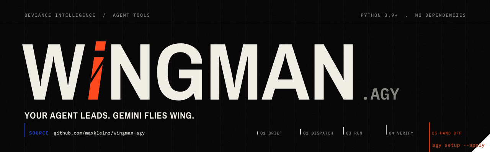

<picture>
  <source media="(prefers-color-scheme: dark)" srcset=".github/assets/wingman-agy-banner-dark.svg">
  <source media="(prefers-color-scheme: light)" srcset=".github/assets/wingman-agy-banner-light.svg">
  
</picture>

<p align="center">
  <a href="https://github.com/maxkle1nz/wingman-agy/releases"></a>
  <a href="https://github.com/maxkle1nz/wingman-agy/actions/workflows/ci.yml"></a>
  <a href="https://github.com/maxkle1nz/wingman-agy/stargazers"></a>
  <a href="LICENSE"></a>
  
  
  
  
  <a href="https://github.com/DEViance-Intelligence"></a>
</p>

# Wingman AGY

`agy` is a command-line bridge to Google Antigravity. From a terminal, you or the agent you
work with (Claude Code, Codex, anything with a shell) can start Antigravity agents on your
Google plan, send them follow-ups and read what they produced. The same CLI calls the Gemini
API directly for one-shot answers, images, speech and embeddings.

```sh
agy new --yes --model gemini-4-hydrogen-high "Read ~/src/shop and list every place we parse dates"
agy tail 3f2a91c0 -f          # watch it work
agy ask "Summarize this diff in two lines" < change.diff
agy img "isometric pixel-art workshop, warm light" -o shop.png
```

<p align="center">
  
</p>

It is one Python file (3.9+, standard library only) plus a small plugin for Antigravity.

## What you get

- `agy new` starts an Antigravity agent in a workspace you
  pick. `agy send` gives it a follow-up. `agy show` and `agy tail` let you read along.
- You can pin Gemini 4 Hydrogen, Gemini 4 Argon, Flash, or one
  of the Claude and GPT models that Antigravity hosts on its own quota.
  - We learned the hard way: for a whole day, `--model pro` silently ran Flash.
  - `agy` now checks which model actually answered and exits with code 4 when it differs.
- Hydrogen handled 90k to 200k tokens of context in our runs. That is a whole
  repo or a pile of specs, and it stays out of your main agent's context window.
- From the Gemini API: `ask` (with Search grounding, JSON output and file input),
  `img`, `tts`, `embed`, and `video` (Veo, paid, asks first). These need a Gemini API key.
- The wingman plugin runs inside Antigravity and only touches conversations that agy
  started.
  - When a network error stops one of them, it continues the run (up to 3 times).
  - It enforces `--max-invocations`, a hard cap on model calls.
- `agy doctor` is one read-only screen. It covers the app, models, quota, permissions,
  plugins, MCP servers, your API key and which of your agents know how to use agy. Anything
  wrong comes with a one-line fix.
- `agy setup --apply`:
  - It shows a plan and asks before each step: install the plugin, find or paste an API key
    (it goes to the macOS Keychain), and add the agy skill to Claude Code, Codex and
    Antigravity so they know how to use it.
  - Each change is written to a manifest, and `agy setup --undo` reverts it.

## Why we use it

A frontier model's best work is deciding, writing a clear brief and checking the result.
Reading 300 files to find one pattern is a poor use of it, and that is where a monthly plan
runs out.

So we split the work:
- Claude Code talks to us and plans. It writes a brief into a file and sends it with
  `agy new`.
- Hydrogen does the long part in a scratch clone.
- Claude reviews. It re-runs the tests itself, reads the diff and sends back a list of
  fixes.

The doctor, the setup command and the wingman plugin were all built that way.

Five reasons to try it:

1. Your Google plan already includes Antigravity agents. If you mostly code with another
   agent, that quota sits idle.
2. Your main agent keeps working with you while two or three Gemini
   agents work elsewhere.
3. Large-context jobs fit in one Gemini run instead of being cut into pieces.
4. Images, speech and embeddings become one command each, so scripts can use them.
5. You stay in control:
   - Nothing changes on your machine without a "yes" typed in a terminal.
   - agy refuses to apply its own setup from inside an agent session.
   - `rm ~/.gemini/config/plugins/wingman` turns the plugin off.

## Miss Gemini CLI?

On June 18, 2026 Google moved free and Google AI Pro / Ultra access from Gemini CLI to
Antigravity ([Google's announcement](https://developers.googleblog.com/an-important-update-transitioning-gemini-cli-to-antigravity-cli/)).
If what you miss is Gemini in your terminal, on the plan you pay for, this gets it back. It
goes through the Antigravity app, and you drive it from the agent you already use.

## Who it's for

People who already work with Claude Code or Codex every day and have a Google AI plan. It
also suits solo builders who want parallel agents without paying API rates for each run, and
anyone who wants Gemini's image and voice models in shell scripts.

## Install

```sh
brew install maxkle1nz/tap/agy
agy setup --apply       # run this yourself, in a terminal
agy doctor
```

Or from a clone: `git clone https://github.com/maxkle1nz/wingman-agy && cd wingman-agy && ./install.sh`
links `agy` into `~/.local/bin`.

You need macOS with Antigravity installed and signed in, and Python 3.9 or newer. A Gemini
API key is optional; `setup` can find one or help you create it.

## Limits

- We have only tested it on macOS (Apple Silicon).
- `agy` talks to the local Antigravity app through its agent endpoint
  and a short allowlist of read calls. These are internal and can change when the app
  updates itself; `agy doctor` shows when something moved.
- Agent runs spend your Antigravity quota (`agy quota` shows what is left).
  `agy video` costs real money.
- Gemini agents tend to report success with confidence. Check the
  work yourself; the agy skill tells your main agent to do the same.
- `agy` never reads or copies your Google login.

This is an independent project, not affiliated with Google, Anthropic or OpenAI. Use your
plans within their terms.

---

<p align="center"><sub>Built by <a href="https://github.com/maxkle1nz">Max Kle1nz</a> at <a href="https://github.com/DEViance-Intelligence">DEViance Intelligence</a>. The deviation is the method.</sub></p>
